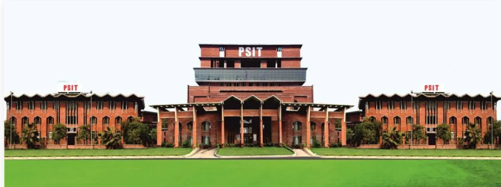

<div align="center">
  

  <h1>🎓 CAMPUS MIND AI</h1>
  <p><strong>Next-Generation Smart Campus Operations Dashboard, Precision GIS Wayfinding & Interactive 3D Digital Twin</strong></p>
  
  <p>
    <a href="https://ameydongre10.github.io/Campus-Mind-AI/"></a>
    
    
    
    
    
  </p>
</div>

<br>

## 🌐 Live Website

Access the production deployment directly on GitHub Pages:  
👉 **[https://ameydongre10.github.io/Campus-Mind-AI/](https://ameydongre10.github.io/Campus-Mind-AI/)**

---

## 📖 Overview

**Campus Mind AI** is a comprehensive single-page web application engineered to modernize institutional university management and campus mobility. Built with high-craftsmanship vanilla web technologies, the platform integrates standard academic schedule planning with enterprise-grade geospatial features, including a multi-layer **2D Precision GIS Navigation System** and a rich, interactive **3D Campus Digital Twin**.

---

## ✨ Key Features & Capabilities

### 🗺️ 1. Precision 2D Campus GIS & Ground-Truth Wayfinding (Leaflet.js)
- **High-Precision Ground-Truth Geolocation**:
  - All **32 campus facilities and academic blocks** are calibrated with high-precision GPS coordinates derived directly from OpenStreetMap and high-resolution Esri World Imagery (aligned with Pranveer Singh Institute of Technology - PSIT Kanpur on NH-19).
  - **Zero Highway Intrusion**: Accurately recognizes the NH-19 National Highway along the south-east perimeter. All buildings, hostels, and athletic fields are strictly positioned on verified physical ground structures inside the campus. The Girls' Hostel and residential complexes are correctly situated in the secure north-western sector, and the Main Campus Gate sits exactly at the NH-19 turnoff avenue.
- **4 Dynamic Basemap Modes**:
  - **CAD Architectural Blueprint**: High-definition architectural vector rendering showing building footprints, perimeter ring roads, covered gallery walkways, central lawns, fountain pins, and courtyard foliage.
  - **Esri World Imagery Satellite**: True-color satellite photography with whisper-light outlines (`fillOpacity: 0.10`). CAD grounds are automatically removed so the **real physical roofs, lawns, cricket pitch, transit yard, and landscaping are 100% visible and unobstructed**.
  - **Carto Light Streets**: Minimalist modern street-map cartography for city-integrated navigation.
  - **Carto Dark Cyber Night**: High-contrast dark cartography for low-light situations.
- **Readable Building Names & Contrast Badges**:
  - Clean, full name badges on every building (e.g. *Block A (CSE)*, *Block B (Software)*, *Campus Tower*, *Admin / Town Hall*, *Central Auditorium*, *Central Library*, *Boys' Hostel*, *Girls' Hostel*, *Main Campus Gate*, *SBI Bank & ATM*, *Medical Infirmary*).
  - In Satellite mode, badges transform into frosted dark glass pills with golden borders (`#FACC15`) and status dots for effortless optical readability against satellite imagery.
- **Dijkstra Shortest-Path Navigation Engine**:
  - Topological pedestrian corridor graph with 37 calibrated nodes and 50 bidirectional edges connecting all 32 destinations.
  - Accurately calculates true pedestrian distance in meters and walking time (at 1.2 m/s average speed).
  - Generates clear, turn-by-turn navigation steps with directional icons and distance markers.
- **Live Walk Simulation**:
  - Real-time animated pedestrian marker (`route-walker-pin`) that traverses the generated route with smooth cubic interpolation and animated path dashes.
- **Interactive Building Inspector Drawer**:
  - Click any building polygon, map pin, or directory item to open a detailed modal drawer showing high-resolution campus photos, department overviews, and three-tier floor room allocations (**Ground Floor p12**, **1st Floor p21**, **2nd Floor p31**).
  - Quick action buttons: *"From Here"*, *"To Here"*, and *"3D View"*.
- **Category Filter Chips**:
  - Filter across *All Blocks*, *Academic Wings*, *Admin & PR*, *Dining & Cafes*, *Hostel Complexes*, *Sports Arenas*, and *Campus Services*.

---

### 🧊 2. Interactive 3D Campus Digital Twin (Three.js)
- **100% Interactive Campus Infrastructure**:
  - Realigned 3D coordinate system reflecting the physical campus orientation: Main Gate and Entrance Boulevard along the front (+Z), leading to the Rangmanch Arena, Central Lawn with animated fountain, and the central Campus Tower apex (-Z).
  - Full raycasting detection across all 32 campus entities: Academic Blocks (A through R), Central Tower, Town Hall Admin, Central Auditorium, Boys' & Girls' Hostels, 1530 kW Solar Power Farm, Elevated Water Tower, Fleet Bus Terminal with signature yellow buses, Multi-deck Parking, SBI Bank Kiosk, and Medical Infirmary.
- **Smooth Glide Camera Tweening**:
  - Clicking any 3D building smoothly glides the camera into an optimal framing angle with cubic ease-in-out interpolation and emits an active highlight pulse.
- **One-Touch Camera Presets Dock**:
  - 🏰 **Main Gate View**: Front entrance perspective looking down the central boulevard.
  - 🏛️ **Central Quad**: Intimate look at the central lawns, fountain, and amphitheatre.
  - 🦅 **Bird's Eye**: High-altitude tactical overview of the entire campus layout.
  - 🔄 **Cinematic Auto-Tour**: Automated 360° slow orbit around campus architecture.
  - 🎯 **Default Perspective**: Quick reset to the classic isometric view.
- **Dynamic Lighting & Atmosphere Switcher**:
  - ☀️ **Daylight**: Crisp natural sunlight, soft green terrain shadows, and bright sky fog.
  - 🌅 **Sunset (Golden Hour)**: Rich amber directional lighting, warm horizon fog, and dramatic long building shadows.
  - 🌙 **Cyber Night Mode**: Dark moody sky (`#0A0F1D`), cyan accent lighting, and glowing illuminated classroom windows.
- **Cross-View Synchronization**:
  - Click *"Navigate Here in 2D"* from any 3D building card to transition directly to the 2D GIS map with origin/destination endpoints auto-populated.

---

### 📅 3. Dynamic Academic Timetable Matrix
- Real-time timetable filtering by academic year and section (Year 2 Section A/B, Year 3 Section A/B).
- Conflict prevention and schedule clash protection across professors and lecture halls.
- Administrative schedule adjustments, emergency interruptions, and automated room reassignment.

---

### 🤖 4. Campus Mind AI Assistant
- Built-in contextual AI agent with live knowledge of placement statistics, company drives (highest CTC, average packages), upcoming tech fests (*Ignitia*), clubs, and institutional policies.
- Direct natural-language routing: asking *"Where is Block A?"* or *"How do I get from Hostel to Library?"* provides instant answers and draws the route on the map with one click.

---

## 🚀 Getting Started

Since this application is built with vanilla web technologies, there are zero complex build steps or dependencies required.

### 1. Clone the repository
```bash
git clone https://github.com/ameydongre10/Campus-Mind-AI.git
cd Campus-Mind-AI
```

### 2. Run locally
- Open `index.html` directly in any modern browser (Chrome, Edge, Firefox, Safari).
- Or run a lightweight local server:
```bash
# Python 3
python -m http.server 8080

# Node.js
npx serve .
```
Then visit `http://localhost:8080`.

---

## 🔐 Demo Credentials

The portal features a built-in authentication system with role-based access:

| Role | Registration ID / Roll No | Password | Permissions |
| :--- | :--- | :--- | :--- |
| **Admin** | `CAMPUS2026102` | `admin123` | Full control, Timetable scheduling, Class cancellation, AI interruptions |
| **Student** | `CAMPUS2026103` | `student@2026` | Personalized timetable, GIS Wayfinding, 3D Campus Explorer, AI Assistant |

---

## 🛠️ Technology Stack

- **Frontend Core:** HTML5, Modern CSS3 (Variables, Flexbox, Grid, Backdrop Filters), Vanilla JavaScript (ES6+)
- **GIS Cartography:** [Leaflet.js 1.9.4](https://leafletjs.com/) with Esri World Imagery & Carto Basemaps
- **3D Graphics Engine:** [Three.js r128](https://threejs.org/) + OrbitControls
- **Icons & Typography:** [FontAwesome 6.4](https://fontawesome.com/), Google Fonts (*Playfair Display*, *Inter*)

---

## 📱 Responsive & Touch-Optimized

- Custom mobile drawer navigation and touch gesture support for OrbitControls in 3D.
- Touch-friendly Leaflet pinch-to-zoom and tapping targets for campus buildings.
- Concentric responsive containers scaling gracefully from 320px mobile screens to 4K displays.

<br>

<div align="center">
  <i>Engineered with precision for modern educational campuses.</i>
</div>
